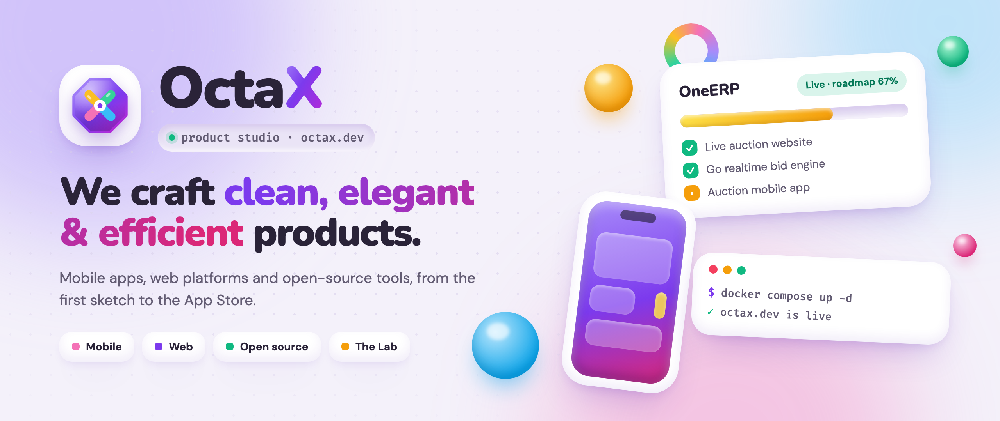

<a href="https://octax.dev">
  <picture>
    <source media="(prefers-color-scheme: dark)" srcset=".github/assets/banner-dark.png">
    
  </picture>
</a>

<p align="center">
  <a href="https://octax.dev"><b>octax.dev</b></a>
  &nbsp;·&nbsp; <a href="https://octax.dev/work">Work</a>
  &nbsp;·&nbsp; <a href="https://octax.dev/lab">The Lab</a>
  &nbsp;·&nbsp; <a href="https://octax.dev/studio">Services</a>
  &nbsp;·&nbsp; <a href="https://octax.dev/llms.txt">llms.txt</a>
</p>

<p align="center">
  
  
  
  
  
</p>

<br>

> **OctaX** is a product studio that designs, builds and runs mobile apps, web platforms and open-source tools.
> This repo is its home on the web: a soft, squishy, **claymorphism** single-page app where every product,
> roadmap and word of copy comes from **one config file**.
>
> Founded and engineered by **Haitham Al-Abdullah**.

<br>

## 📦 Our products

| Product | What it is | Status | Links |
|---------|------------|--------|-------|
| **OneERP** | ERP and live-auction platform for a vehicle-auction business | Live | [mwsauction.com](https://mwsauction.com) · [details](https://octax.dev/work/oneerp) |
| **Octax Solobill** | Billing for solo traders who resell services, on the web and iPhone | Live · MIT | [inv.octax.dev](https://inv.octax.dev) · [web source](https://github.com/octax-app/solobill) · [iOS source](https://github.com/octax-app/solobill-ios) |
| **Octa Pass** | The free, end-to-end encrypted password manager only you can open | Public alpha · MIT | [octap.app](https://octap.app) · [web vault](https://vault.octap.app) · [source](https://github.com/octap-app/octapass) |

<br>

## 🧭 A tour of the site

| | Page | Route | What lives there |
|:-:|------|-------|------------------|
| 🏠 | **Home** | `/` | Hero, stats band, catalog preview, pipeline, demos & open source, founder card |
| 🗂️ | **Work** | `/work` | The full catalog with filter chips: products, mobile, web, open source, in progress |
| 📱 | **Project** | `/work/:id` | Details, tags, store and repo links, and a screenshot gallery |
| 🧪 | **The Lab** | `/lab` | What's being built right now, with milestone-driven progress bars |
| 🛠️ | **Services** | `/studio` | What Octax offers, how it works, and what it values |
| ⚡ | **Stack** | `/skills-tools` | Favourite stack and grouped skills |
| 👋 | **About** | `/experience` | The founder and the timeline |

<br>

## ✨ What makes it tick

<table>
<tr>
<td width="50%" valign="top">

### 🧱 One file runs everything
Every page renders from [`src/config/AppConfig.js`](src/config/AppConfig.js). Add a project, move a milestone or rewrite the hero without opening a component.

</td>
<td width="50%" valign="top">

### 🧪 Progress you can see
Give a project `milestones` and it appears in **The Lab** with a progress bar calculated from them (`done` = 1, `active` = ½, `todo` = 0).

</td>
</tr>
<tr>
<td valign="top">

### 🌗 Clay, in light and dark
Surface colours are CSS variables, so both themes swap in one place. Follows the system theme, has a toggle, and <kbd>D</kbd> flips it from the keyboard.

</td>
<td valign="top">

### 🤖 Readable by crawlers and AI
A small Vite plugin generates `sitemap.xml`, `llms.txt` and `llms-full.txt` from the config, and injects JSON-LD and a no-JS summary into `index.html`.

</td>
</tr>
<tr>
<td valign="top">

### 🎞️ Motion with restraint
Scroll reveals with Framer Motion, Swiper galleries, springy hovers, and a tidy placeholder whenever a screenshot is missing.

</td>
<td valign="top">

### 🐳 Ships as one image
A multi-stage Dockerfile builds the site and serves it with nginx. The build fails if `sitemap.xml` or `llms.txt` is missing.

</td>
</tr>
</table>

<br>

## 🎨 The palette

Six vibrant tones sit on a lavender canvas (never pure white). Apply any of them with a `.tone-*` class.

<p>
  
  
  
  
  
  
</p>

Type is **Nunito** for display, **DM Sans** for body text and **Fira Code** for code. Corners are rounded at `20px`, `32px` and `44px` (`rounded-clay-sm`, `rounded-clay`, `rounded-clay-lg`).

<br>

## 🚀 Quick start

> Requires **Node.js 20.19+ or 22.12+** (Vite 8) and npm.

```bash
git clone https://github.com/octax-app/portfolio-website.git
cd portfolio-website
npm install
npm start          # → http://localhost:3000
```

| Command | What it does |
|---------|--------------|
| `npm start` / `npm run dev` | Dev server with hot reload. SEO files are served live too |
| `npm run build` | Production build into `build/`, including `sitemap.xml` and `llms*.txt` |
| `npm run preview` | Serve the production build locally |

<br>

## 🧩 Adding a project

Add an entry to `App.Catalog` in [`AppConfig.js`](src/config/AppConfig.js):

```js
{
  id: "solobill",                 // → /work/solobill
  name: "Octax Solobill",
  kind: "platform",               // platform | mobile | webapp | website | library | community
  tone: "violet",                 // violet | pink | amber | mint | sky | coral
  aliases: ["old-id"],            // optional, after a rename: /work/old-id redirects here
  status: "live",                 // live | beta | alpha | building | private
  openSource: "public",           // public | in-progress | planned (optional)
  featured: true,
  tagline: "Billing for solo traders who resell services.",
  tags: ["TypeScript", "React", "Hono", "SQLite"],
  links: {
    demo: { label: "Try it free", href: "https://inv.octax.dev" },
    // demo / site / admin also take an optional `kind` and `note` for their
    // live-demo card, e.g. { …, kind: "Web vault", note: "Free account" }
    repo: "https://github.com/octax-app/solobill",
    repoIos: {                    // optional second repo for the iOS app
      label: "iOS source",
      href: "https://github.com/octax-app/solobill-ios",
      note: "The native iPhone app: SwiftUI, no dependencies.",
    },
  },
  milestones: [                   // optional → shows up in The Lab
    { title: "Web app", state: "done" },
    { title: "iOS app", state: "done" },
  ],
}
```

Store buttons, status pills, open-source badges and filters all appear automatically from these fields. The sitemap and `llms.txt` update on the next build.

**Images**

- Mobile screenshots: `public/static/images/work/apps/<id>/screenshot_<n>_<light|dark>.webp`
- Gallery shots: `public/static/images/work/gallery/<id>/…`, listed under the project's `gallery` as `{ src, caption }`. Add `device: "mobile"` for a phone frame, or `url: "octap.app"` to show a different address in the browser frame than the project's main link
- Missing images show a "preview coming soon" placeholder, so you can add them later.

<br>

## 📁 Project map

```
src/
├── config/
│   ├── AppConfig.js        👈 all content: catalog, pages, copy, links
│   └── seo.js              JSON-LD, sitemap, llms.txt builders
├── core/                   app shell: routes, navbar, footer, logo
├── pages/
│   ├── home/               hero · stats · catalog · pipeline · demos · founder · CTA
│   ├── work/               catalog + project details & gallery
│   ├── lab/                in-progress work and milestones
│   ├── studio/             services, process, values
│   ├── skills/             the stack
│   └── experience/         about & timeline
├── shared/                 clay UI kit: cards, pills, chips, progress, gallery, SEO
└── index.css               design tokens + Tailwind
public/static/images/       screenshots & gallery
nginx/                      server config + snippets
.github/assets/             README banner (source + renders)
vite.config.js              the octax-seo plugin lives here
```

<br>

## 🐳 Deploy

The site ships as a single nginx image, built in Docker and served behind a shared Traefik proxy:

```bash
docker compose up -d --build      # build the site + image, then (re)start
git pull && docker compose up -d --build   # deploy an update
```

[`compose.yaml`](compose.yaml) routes `octax.dev` (and redirects `www.` to it) through Traefik with Cloudflare-issued TLS. The image includes a `/healthz` health check.

You can also host it somewhere else: `npm run build`, upload `build/` to any static host, and rewrite every route to `index.html`, since this is a single-page app.

<br>

## 📄 License

The code is [MIT](LICENSE): use it however you like. The Octax name, logo, product screenshots and personal content belong to their owner.

<br>

<p align="center">
  <a href="https://octax.dev"></a>
  <br>
  <sub>Crafted with care in the UAE · <a href="https://octax.dev">octax.dev</a> · <a href="https://github.com/octax-app">@octax-app</a></sub>
</p>
